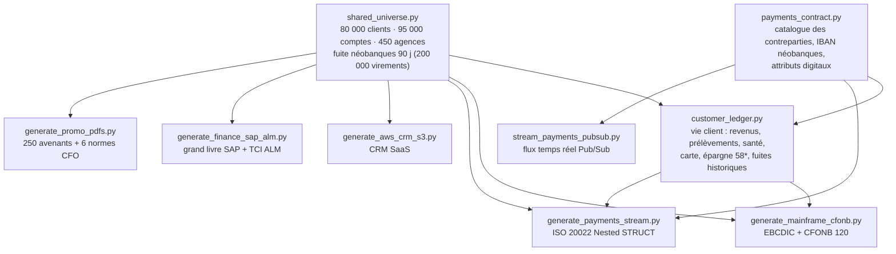

# Générateurs de données — `00_data_generator/`

Génération **déterministe** (`seed=2026`) des 5 silos de la Banque Hexagone. Tous les silos décrivent les mêmes clients, les mêmes comptes et la même vie client. Les invariants d'[`AGENTS.md`](../AGENTS.md) §2 sont donc vérifiables au centime près d'un silo à l'autre.

## Architecture : une seule vérité, plusieurs vues



- **`shared_universe.py`** : référentiel maître (clients, comptes, agences, IBAN, client témoin `CUST00002026`) et fuite exacte de 2 420 000 000,00 € sur 90 jours. Mis en cache dans `data/universe/`.
- **`customer_ledger.py`** : journal unique de toutes les opérations réglées hors témoin et hors fuite 90 j. Le Mainframe et le flux SEPA en sont deux vues ; chaque paiement réglé d'un compte présent dans le Mainframe J-1 existe à l'identique dans les deux (même `end_to_end_id`, même date, même montant). Mis en cache dans `data/universe/customer_ledger_v2.parquet`.
- **`payments_contract.py`** : contrat partagé entre l'historique SEPA et le flux temps réel (contreparties, IBAN externes à clé MOD-97, canal, SCA, IP).

## Ce que produit chaque générateur
| Script | Sortie (`output/`) | Contenu | Anomalies RAW injectées |
|---|---|---|---|
| `generate_mainframe_cfonb.py` | `corebanking/` | Maîtres clients (79 350) et comptes (94 350) en EBCDIC CP500 + COMP-3 ; 18 mois de relevés CFONB 120 (5 500 000 mouvements `04` + compléments SEPA `05`) | fichier `202610_RUN01` en `ABEND_S0C7` ; 1,2 % de dates de valeur `00000000`/`99999999` ; ~12 % de codes guichet décalés ou vides |
| `generate_payments_stream.py` | `RAW/PAYMENTS/` | 6 200 000 événements pacs.008 (Nested STRUCT) + enrôlements IBAN | 3,4 % de doublons `end_to_end_id` ; 8,1 % de `RJCT`/`PDNG` |
| `generate_aws_crm_s3.py` | `RAW/AWS/` | 80 000 clients, 95 000 comptes, 320 000 interactions, 450 agences | 650 comptes créés après le batch Mainframe J-1 |
| `publish_aws_crm_iceberg.py` | `gs://…/RAW/AWS_SAAS_ICEBERG/` | Publication du CRM en tables Apache Iceberg (PyIceberg) | — |
| `generate_finance_sap_alm.py` | `RAW/FINANCE_SAP_ALM/` | 1 200 000 écritures SAP (réel, budget, TCI ALM, liaisons 58*) | piège de signe : naïf +42,80 M€ vs signé -24,12 M€ |
| `generate_promo_pdfs.py` | `RAW/PROMO_CONTRACTS_PDF/`, `RAW/REGULATORY_CFO_PDF/` | 250 avenants d'agence (-14,30 M€) + 6 PDF réglementaires | montants hors-SAP |
| `stream_payments_pubsub.py` | Cloud Pub/Sub | Événements temps réel (`--burst`, `--witness-live`) | retries, rejets |

## La vie client (`customer_ledger.py`)
Pour chaque compte courant Mainframe :
- **revenu mensuel** stable (salaire versé du 1er au 5, retraite le 9 pour les 64 ans et plus) ;
- **prélèvements fixes** : loyer (le 5), EDF saisonnier, box, assurance, impôts (janvier à octobre), streaming à 15,99 € puis **19,99 € à partir du 01/11/2026** ;
- **remboursements santé** ponctuels (CPAM, mutuelle), **dépenses carte** variables, **épargne programmée** vers un livret (58*) ;
- **fuites historiques** vers les néobanques avant le 13/08/2026.

Les volumes sont calculés pour respecter exactement les invariants des deux silos : 5 487 000 paiements SEPA réglés uniques et 5 500 000 mouvements CFONB.

> [!NOTE]
> Limite connue : avec 5,5 M de mouvements pour 80 000 clients, chaque client a 3 à 5 opérations par mois. La plupart affichent donc un excédent mensuel élevé ; seul le client témoin est calibré finement (+300 € de reste à vivre).

## Générer et vérifier
```bash
uv sync
./scripts/generate_all_data.sh --local-only     # tous les silos en local
uv run python 00_data_generator/validate_corebanking.py         # Mainframe : 10 contrôles, dont Mainframe <-> SEPA
uv run python 00_data_generator/validate_payments_coherence.py  # paiements historique <-> temps réel : 9 contrôles
uv run python 00_data_generator/verify_invariants.py            # contrôle croisé entre silos : 15 contrôles
```
`generate_all_data.sh` (sans `--local-only`) synchronise ensuite vers GCS et charge la Finance dans BigQuery. Le rechargement des tables Mainframe et paiements dans BigQuery se fait avec les scripts `scripts/run_demo1_*.sh` (voir le [README](../README.md)).

## Modifier un générateur sans casser la démo
1. **Toujours passer par le référentiel partagé** : une nouvelle opération client va dans `customer_ledger.py`, jamais dans un seul générateur.
2. **Invalider les caches** si l'univers ou le journal change : supprimer `data/universe/` ou incrémenter `LEDGER_VERSION`.
3. **Relancer les 3 validateurs** : ils doivent rester verts (les assertions des générateurs bloquent déjà toute dérive des invariants).
4. **Brancher tout nouveau générateur** dans `scripts/generate_all_data.sh` et `scripts/clean_all_data.sh` (AGENTS.md §3).
5. **Recharger le cloud** (Mainframe via Spark, paiements via BigLake), puis reconstruire la couche SILVER (`dbt build`).
