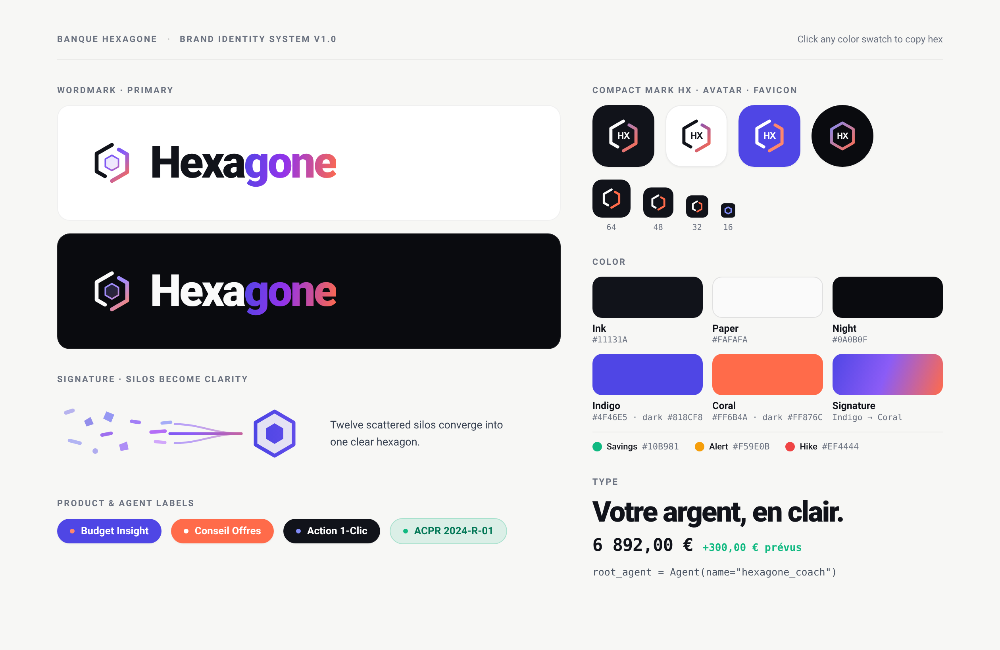
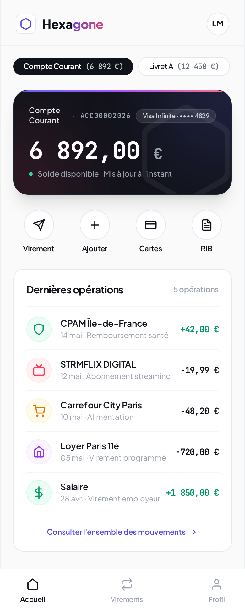
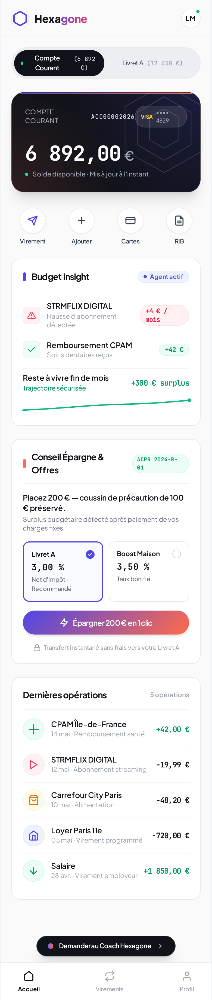

# Couche GOLD Démo #4 — `dp_budget_insight` (`gold_bank`) & Scale Mobile

Ce dossier regroupe les artefacts analytiques (`BigQuery AI` / `AI.FORECAST` TimesFM 2.5), la synchronisation opérationnelle `AlloyDB` (`alloydb_sync`, `< 15 ms`) et les 3 agents mobiles `ADK` (*Budget Insight*, *Conseil Offres*, *Action*).

## Architecture GOLD (`gold_bank` · Data Product `dp_budget_insight`)

Les modèles de production sont industrialisés dans le projet `dbt` unique ([`02_demo2_silver_dbt_dq/models/gold/budget_insight/`](../02_demo2_silver_dbt_dq/models/gold/budget_insight/)) pour préserver le lineage complet `RAW → SILVER → GOLD`, la documentation `persist_docs` (`INFORMATION_SCHEMA` / Knowledge Catalog) et les tests de conformité `ACPR 2024-R-01`.

| Table `gold_bank` | Grain | Rôle dans la Démo #4 & l'agent conversationnel |
| :--- | :--- | :--- |
| `customer_transactions_enriched` | 1 ligne par mouvement réglé (~5,5 M) | Transactions prêtes pour l'agent conversationnel : libellés FR, `merchant_name` 100 % renseigné (0 NULL sur les paiements carte, noms commerciaux néobanques), `is_neobank_outflow` booléen strict, zéro IBAN PII. |
| `customer_monthly_spending` | `customer_id × period_month × category × direction` | Agrégats mensuels pré-calculés avec variation `M vs M-1`, moyenne 3 mois et part des dépenses mensuelles (`< 15 ms` dans AlloyDB). |
| `customer_recurring_commitments` | `customer_id × category` récurrente | Détection des revenus/charges récurrents, alertes proactives de hausse d'abonnement (`STRMFLIX DIGITAL` `15,99 € → 19,99 €`, `+4,00 €`) et charges restant à passer avant fin de mois. |
| `customer_card_spending_forecast` | 1 ligne par client (`80 000`) | Prévision zéro-shot `AI.FORECAST` (`TimesFM 2.5`, horizon 1 mois, IC 80 %) des dépenses carte mensuelles, avec repli statistique pour les clients `< 3` mois d'historique. |
| `customer_mobile_insights` | 1 ligne par client (`80 000`) | Table maîtresse synchronisée vers `AlloyDB` pour les 3 agents ADK : reste à vivre projeté (`+300,00 €` pour `CUST00002026`), alertes récentes et offre conforme `ACPR 2024-R-01` (coussin `>= 100 €`, plafond `70 %`, priorité Livret A / LDDS puis `Livret Boost Maison 3,50 %` sur 3 mois). |

## Construire & tester la couche GOLD (`dp_budget_insight`)

```bash
cd 02_demo2_silver_dbt_dq
uv run dbt seed --profiles-dir . --select movement_categories budget_insight_rules
uv run dbt build --profiles-dir . --select path:models/gold/budget_insight
```

## Backtesting chronologique `TimesFM 2.5` (`AI.EVALUATE`)

```bash
bq query --use_legacy_sql=false --project_id=data-days-demo --location=europe-west1 \
  --label datacloud:antigravity < 04_demo4_scale_mobile_adk/sql/01_evaluate_timesfm_budget_forecast.sql
```

## Socle opérationnel AlloyDB (`bigquery_fdw`, `alloydb_sync`, Read Pool & Action Agent)

Voir [`ALLOYDB_SETUP.md`](./ALLOYDB_SETUP.md) pour le détail du cluster `hexagone-d4-alloydb` (PostgreSQL 18), la fédération `bq_fed.*`, les 6 tables synchronisées `alloydb_sync`, l'ingestion temps réel Pub/Sub → Cloud Run → AlloyDB et le script de reset [`sql/alloydb/03_reset_demo4.sql`](./sql/alloydb/03_reset_demo4.sql).

## Identité Visuelle & Maquettes Mobile — Banque Hexagone (`design/`)

Le système de marque et les maquettes mobiles (conçues dans **Stitch**, projet `717705868757685868`, édition **Light Stage** optimisée pour la projection en plénière) sont versionnés dans [`design/`](./design/) :

- [`design/DESIGN.md`](./design/DESIGN.md) : tokens de couleur (`Ink #11131A`, `Paper #FAFAFA`, `Indigo #4F46E5`, `Coral #FF6B4A`), typographie et composants.
- [`design/hexagone_brand_sheet.html`](./design/hexagone_brand_sheet.html) : planche de marque interactive (wordmarks, icônes `HX`, motif *Silos Become Clarity*, swatches click-to-copy).
- [`design/PRD_DEMO4.md`](./design/PRD_DEMO4.md) : PRD complet de la Démo #4 (architecture dual-repo `starter`/`final`, 3 issues GitHub, agents ADK sur Gemini Hydrogen, skills déterministes et reset).

### Planche de marque Hexagone



### Écrans Mobile — Avant / Après (même socle Light, 3 fonctionnalités agentiques intégrées)

| Avant — Accueil Classique (`starter`) | Après — Accueil Agentique (`final`) |
| :---: | :---: |
|  |  |
| Solde `6 892,00 €`, carte Ink, actions rapides & `Dernières opérations` | Même socle + **Budget Insight** (`STRMFLIX +4 €`, `CPAM +42 €`, `TimesFM +300 €`), **Conseil Épargne** (`ACPR 2024-R-01`, `200 €` en 1 clic) & **Coach IA** |
