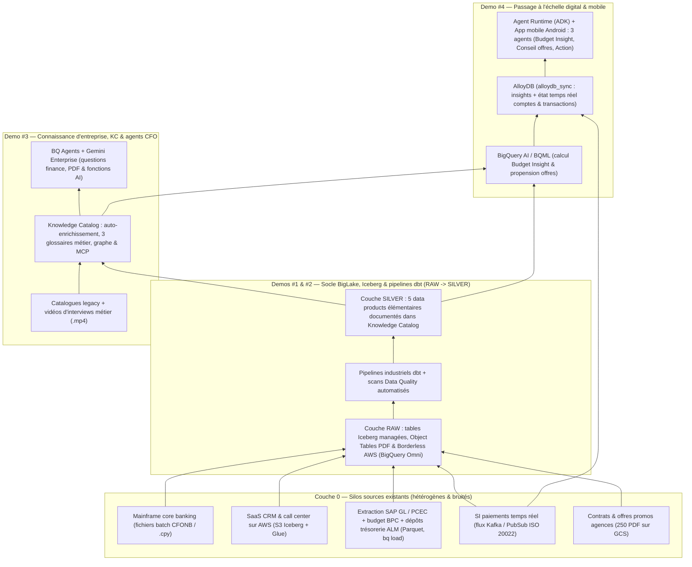

# Paris Data Summit 2026 — Design & contexte projet (Antigravity)

> [!IMPORTANT]
> Ce document sert à la fois de **blueprint d'architecture** pour la Squad démo et de **fichier de contexte de référence (`DESIGN.md` / `AGENTS.md`) pour Antigravity (`AGY`)** et le **Data Agent Kit (`DAK`)**. Il décrit le contexte métier, les silos sources simulés, l'architecture cible sur Google Data Cloud, le déroulé des 4 démos live et les invariants chiffrés que les jeux de données et pipelines doivent respecter.

---

## 1. Contexte métier & fil rouge de la plénière

### L'entreprise fictive & le double électrochoc du CEO
Nous simulons le système d'information d'une **grande banque de détail française** (80 000 clients représentatifs à l'échelle démo, 450 agences réparties sur 8 régions). En moins de 12 heures, le Directeur Général (CEO) vit deux chocs :

1. **En interne — Le « gap de chiffres » du CFO :**
   * Le **rapport commercial (CRM réseau & call center)** annonce : **`0 %` d'attrition**, tous les comptes courants jeunes/actifs toujours ouverts, et **`+15 000` nouveaux comptes** sur le trimestre.
   * Le **rapport finance & trésorerie (CFO / ALM)** constate une hémorragie : **`2,42 Md€` de dépôts à vue évaporés en 90 jours**, obligeant la banque à se refinancer au taux interbancaire (€STR), et une **marge nette d'intérêt (PNB) qui décroche de `-38,42 M€`** par rapport au budget.
   * **Explication métier (*churn silencieux*) :** les clients ne ferment plus leur compte historique, mais dès que leur salaire tombe entre le 1er et le 5 du mois, ils **transfèrent leurs liquidités en 10 secondes par virement SEPA Instant** vers des néobanques et courtiers en ligne. Les données étant éclatées entre Mainframe batch, flux paiements, SaaS CRM sur AWS, base Finance SAP/PCEC et contrats PDF, il faut 3 semaines d'Excel aux équipes du CFO pour comprendre la fuite.
2. **En externe — L'expérience mobile temps réel :**
   * Le soir même, le fils du CEO lui montre sur son smartphone comment une néobanque affiche instantanément *« Ce qui s'est passé depuis votre dernière connexion »*, anticipe son budget de fin de mois et lui propose d'épargner en un clic.

### Le mandat confié à la Squad
Bâtir sur **Google's Agentic Data Cloud** un socle unique, sans copie inutile, gouverné de bout en bout, capable à la fois :
* de **fiabiliser et réconcilier les KPI du CFO au centime près** dans `Gemini Enterprise` (avec économie massive de tokens),
* et de **passer à l'échelle côté digital** avec des agents clients temps réel (`Budget Insight`, `Conseil offres`, `Action`) connectés à l'application mobile.

---

## 2. Architecture globale des données (de `RAW` aux agents à l'échelle)



---

## 3. Découpage détaillé des 4 démos live

### Démo #1 — Agrégation de la couche `RAW` sans copie (Clément + Matt)
* **Persona :** Data Engineer qui découvre la vitesse d'`Antigravity (AGY)` + `Data Agent Kit (DAK)` face à un SI bancaire éclaté.
* **État initial :**
  * Fichiers batch Mainframe au format fixe illisible (`CFONB 120` / Copybook `.cpy`, encodage legacy).
  * Données CRM & interactions call center hébergées dans un SaaS sur **AWS** (`S3` + `Glue`).
  * Données Finance / comptabilité : extraction du **grand livre SAP / PCEC** (+ budget BPC et dépôts quotidiens de la Trésorerie ALM), **préchargée en coulisses** dans `raw_bank.raw_sap_gl_alm` par `bq load` (aucune étape sur scène).
  * Flux d'événements de paiements temps réel (`Kafka` / `Pub/Sub` en `ISO 20022 pacs.008` & JSON).
  * Contrats et avenants promotionnels en **PDF** non structurés sur GCS.
* **Actions réalisées dans `AGY` (6 étapes conversationnelles interactives) :**
  1. *Récupérer les données mainframe* : transfert binaire strict Mainframe z/OS (`EBCDIC CP500 + COMP-3`, conservation d'audit du lot `ABEND_S0C7`) vers GCS `RAW/`.
  2. *Chargement et nettoyage mainframe* : décodage **Dataproc Serverless Spark** vers 4 tables **BigLake Managed Iceberg** documentées (`72/72` colonnes).
  3. *Connecter aux données CRM (AWS)* : création par agent du lien **Borderless Lakehouse** vers AWS (`AWS Glue / S3`, zéro copie).
  4. *Intégrer les données de paiement* : branchement temps réel sans serveur **Cloud Pub/Sub → BigQuery Subscriptions (`--use-table-schema`)** en schéma **`100 % Nested STRUCT`** (`ISO 20022 pacs.008` & enrôlements IBAN, `55/55` chemins documentés, `DLQ`), suivi d'un **audit hybride PII in-database** (détectant 10 sous-champs sensibles dont des motifs médicaux RGPD Art. 9) et de l'application chirurgicale du **Column-Level Security (`CLS` : `LAST_FOUR_CHARACTERS`, `SHA256`, `ALWAYS_NULL`)** directement sur les feuilles des `STRUCT`.
  5. *Indexer les contrats PDF des agences* : découverte automatique sans DDL des `250` PDF d'agences et `6` PDF réglementaires CFO via **Dataplex Cloud Storage Discovery (`Object Tables`)**.
  6. *Cataloguer les sources pour l'équipe Data* : initialisation de la structure industrielle **`dbt`** (`_raw_sources.yml`) et synchronisation de la **documentation technique initiale** dans `Knowledge Catalog`.
* **Briques Google Cloud démontrées :** `Antigravity` + `DAK`, `Dataproc Serverless Spark` + `BigLake Managed Iceberg`, `Borderless Lakehouse`, `Pub/Sub BigQuery Subscriptions (Nested STRUCT)` + `Column-Level Security (Data Policies)`, `Dataplex Cloud Storage Discovery (Object Tables)`, `Knowledge Catalog`.
* **Transition vers Démo #2 :** *Jojo (Data Steward) intervient : « Vous avez branché les tuyaux et protégé les PII, mais regardez l'état de la qualité métier en RAW — si on expose ça, tout va planter ! »*

---

### Démo #2 — Industrialisation `SILVER` & Data Quality dans `dbt` (L'équipe Data)
* **Persona :** L'équipe Data qui industrialise la passage de `RAW` à `SILVER` avec des garanties de qualité.
* **État initial :** Données `RAW` accessibles mais truffées d'anomalies réelles (doublons de retry sur le flux paiements, dates mainframe `00000000`, codes agences `NULL`, statuts techniques `RJCT`/`PDNG` mélangés aux virements exécutés `ACSC`).
* **Actions réalisées dans `AGY` :**
  1. **Conception des Data Products** avec `AGY` : revue du découpage (par domaine métier & usage, plus par système source), choix des noms techniques en anglais et de l'architecture de fraîcheur (`dbt` planifié dans BigQuery, ajustement temps réel dans `AlloyDB`). Le résultat est consigné dans [`data_products_catalog.yaml`](./02_demo2_silver_dbt_dq/kc_products/data_products_catalog.yaml).
  2. **Définition des règles de Data Quality** avec l'Agentic Data Cloud : le profil Dataplex révèle les anomalies de forme, l'API Dataplex `generateDataQualityRules` en déduit les règles techniques, Knowledge Catalog apporte les règles métier (contrats des Data Products) et l'agent ajoute les règles de cohérence inter-silos. Un **agent Data Quality Scan** applique ensuite ces règles sur `RAW` et remonte les anomalies concrètes.
  3. Itération assistée dans `AGY` pour générer les modèles **`dbt` (`SILVER`)** intégrant nativement les tests `dbt` et les règles de **Data Quality** BigQuery/KC (dépliage des `STRUCT` paiements, dédoublonnage `end_to_end_id`, filtrage `ACSC`).
  4. Publication des **5 Data Products `SILVER`** dans `Knowledge Catalog` :
     * `dp_customer_360` *(référentiel client & comptes : `customers`, `accounts` — 80 000 clients, 95 000 comptes, solde J-1)*
     * `dp_customer_timeline` *(vie du client : `customer_movements` catégorisés et dédoublonnés, `beneficiaries` — fait apparaître la fuite de `2,42 Md€` vers les néobanques)*
     * `dp_customer_relationship` *(interactions CRM : `interactions` — 320 000 RDV et appels, texte sensible masqué)*
     * `dp_finance_pnb` *(grand livre SAP, budget & TCI ALM : `gl_entries`)*
     * `dp_commercial_commitments` *(contrats promotionnels PDF extraits par IA : `promo_contracts` — `-14,30 M€`)*
  * Les 2 Data Products **`GOLD`** sont construits ensuite : `dp_certified_pnb` (Démo #3, `-38,42 M€`) et `dp_budget_insight` (Démo #4, prévision de fin de mois par client).
* **Briques Google Cloud démontrées :** `Knowledge Catalog Data Products`, `Auto Data Quality`, intégration `dbt` + `DAK`.
* **Transition vers Démo #3 :** *« Jojo Fiero » : fier de ses Data Products 100 % propres au scan DQ, Jojo crée un premier `BQ Agent` et file répondre aux questions du CFO...*

---

### Démo #3 — Connaissance métier dans `Knowledge Catalog` & pilotage CFO (Jojo)
* **Persona :** Data Steward qui capture toute la finesse métier de l'entreprise pour ancrer les agents dans le réel et diviser la consommation de tokens.
* **État initial :** La Data Quality technique est désormais au vert (`SILVER`), **mais le contexte métier de la banque est absent des schémas**. Résultat : sur des KPI financiers composites, les agents hallucinent des formules fausses avec aplomb.
* **Actions réalisées en 2 temps :**
  1. **Le crash sémantique (« Fake résultat ») :**
     * Création d'un **`BQ Agent`** dans BigQuery Studio branché sur les tables `SILVER`, interrogé depuis **`Gemini Enterprise`** sur 4–5 questions Finance du CFO.
     * La requête SQL s'exécute sans erreur technique, mais renvoie un **résultat métier aberrant (`+42,8 M€` de hausse de marge au lieu de `-38,42 M€`)** car l'agent ignore les règles de signe comptable (`SENS_DC` / `SHKZG`), compte les virements internes compte-à-livret (`58*`), additionne la charge de refinancement ALM au lieu de la déduire et ignore les remises commerciales stockées dans les PDF.
  2. **Capture de la connaissance & ancrage `Knowledge Catalog` dans `AGY` :**
     * Import et réconciliation des **catalogues legacy** de la banque (exports CSV/JSON historiques incomplets ou contradictoires entre Réseau Commercial et Finance).
     * Ingestion multimodale des **vidéos d'interviews métier pré-enregistrées (`.mp4`)** où les sachants (responsable ALM, contrôle de gestion, réseau) expliquent à l'oral les vraies règles de calcul du PNB net et le rôle des avenants PDF.
     * Construction du **graphe de connaissance** et auto-enrichissement de `Knowledge Catalog` (**3 glossaires métier** : *Finance & ALM*, *Paiements & Comptes*, *Client & Commercial* + définitions certifiées des KPI).
  3. **Le replay gagnant dans `Gemini Enterprise` :**
     * On ré-utilise **le même `BQ Agent`** désormais ancré sur `Knowledge Catalog` : les réponses tombent **justes au centime près (`-38,42 M€`)**, exploitent les **PDF** et les **fonctions AI** (`AI.FORECAST` / `AI.GENERATE`), avec une **réduction massive du nombre de tokens** consommés.
* **Briques Google Cloud démontrées :** `BQ Agents`, `Knowledge Catalog` (agrégation, `Self-Enrichment`, graphe & glossaires), `Gemini Enterprise`, fonctions AI & multimodal PDF.

---

### Démo #4 — Passage à l'échelle côté Digital : `BQML`, `AlloyDB` & 3 agents `ADK` (Matt + Clément)
* **Persona :** Équipe Digital / Produit + Data qui transforme ce socle gouverné en expérience mobile agentique à grande échelle.
* **État initial :** Application mobile bancaire classique et statique (simple affichage des soldes passés).
* **Objectif produit :** Intégrer **3 agents spécialisés** dans l'expérience mobile :
  1. **`Agent Budget Insight`** : analyse des mouvements récents (*« Depuis votre dernière connexion »*, détection de hausse d'abonnement `+4 €`) et projection prédictive du reste à vivre de fin de mois (`+300 €`).
  2. **`Agent Conseil Offres`** : recommandation personnalisée et éligible (ex. placement de l'excédent sur un livret rémunéré maison boosté, évitant la fuite vers une néobanque).
  3. **`Agent Action`** : exécution transactionnelle sécurisée en 1-clic (virement interne d'épargne ou souscription d'offre).
* **Actions réalisées :**
  1. **Dans `Antigravity (AGY)` avec `DAK` :** génération accélérée des *User Journeys* et des features/modèles **`BQML`** (`TimesFM` / propension offres) — l'agent code juste du premier coup car il s'appuie directement sur les schémas `SILVER` et la sémantique de `Knowledge Catalog`.
  2. **Synchronisation opérationnelle (`alloydb_sync`) :** exposition haute performance vers **`AlloyDB`** des insights calculés dans BigQuery, combinés aux soldes valorisés `J-1` et au flux temps réel des paiements du jour `J` (`< 15 ms` de latence).
  3. **Dans `Android Studio` :** intégration dans l'application mobile des fonctions intelligentes et orchestration des **3 agents développés avec `ADK`** déployés sur **`Agent Runtime`**.
* **Briques Google Cloud démontrées :** `BQML` / `BigQuery AI`, `AlloyDB` (`alloydb_sync`), `ADK` & `Agent Runtime`.

---

## 4. Spécifications & invariants du jeu de données à simuler (`seed=2026`)

Pour que les 4 démos racontent une seule et même histoire cohérente sans jamais tricher avec des mocks codés en dur, le générateur de données doit garantir les invariants suivants :

### A. Volumétrie cible (optimisée pour `< 2 s` de requête en live)
* **Clients (`CRM AWS S3`) :** `80 000` clients particuliers répartis sur `8 régions` et `450 agences`, `0` clôture de compte sur le trimestre, `+15 000` ouvertures récentes, `320 000` notes de RDV agence & verbatims d'appels call center.
* **Comptes & opérations (`Core banking` + `SI paiements`) :** `95 000` comptes courants/livrets, `~5,5 M` d'écritures valorisées batch et `~6,2 M` d'événements dans le flux paiements sur 18 mois (schéma `100 % Nested STRUCT` ISO 20022 aligné entre Parquet historique et flux temps réel Pub/Sub).
* **Finance & PDF :** `1,2 M` de lignes comptables agrégées (`raw_bank.raw_sap_gl_alm`), `250` vrais fichiers PDF d'offres promotionnelles sur GCS, `6` PDF réglementaires CFO (`ANC`, `ALM`, `ILAAP`, `Comité des Risques`, `UE 2024/886`, `ACPR 2024-R-01`), et un référentiel d'`offres_epargne` pour la Démo #4.

* **Vie du client cohérente entre silos :** un journal unique (`customer_ledger.py`) décrit la vie de chaque client — revenu mensuel stable (1er-5 du mois, retraite le 9), prélèvements fixes (loyer, EDF saisonnier, box, assurance, impôts, streaming `15,99 €` → `19,99 €` au 01/11/2026), remboursements santé, dépenses carte et épargne programmée. Le Mainframe CFONB et le flux SEPA en sont deux vues : `0` écart au rapprochement.

### B. Anomalies `RAW` obligatoires (pour le tacle de Jojo & la Démo #2)
1. **Doublons techniques de flux (`SI paiements`) :** ~`3,4 %` d'événements en doublon sur `end_to_end_id` (retries réseau) + présence de statuts rejetés/en attente (`RJCT`, `PDNG` = `8,1 %` des messages).
2. **Corruptions de format Mainframe (`Core banking`) :** dates de valeur non renseignées encodées en `00000000` ou `99999999` (~`1,2 %` des lignes) et codes agences non normalisés (`'0042'` vs `'42  '`).
3. **Clés orphelines inter-silos :** ~`650` comptes récents créés en agence sur AWS S3 pas encore réconciliés dans le référentiel client Mainframe du soir.

### C. Invariants métier & financiers (pour la Démo #3 — `Fake` vs `Certifié`)
* **Fuite réelle des dépôts à vue (90 jours) :** exactement **`2 420 000 000 €`** de virements sortants compensés (`ACSC`) vers des BIC de néobanques/courtiers (`REVOLT21`, `TRBKDEBB`, etc.), dont **`68,0 %`** chez les **18–32 ans** concentrés entre le **1er et le 5 du mois**.
* **Résultat « FAKE » du `BQ Agent` avant `Knowledge Catalog` :** **`+42,80 M€`** (obtenu systématiquement lorsqu'un SQL naïf `SUM(gross_amount_eur)` somme les montants bruts non signés — réel et budget en contre-valeur négative — sans appliquer le sens Débit/Crédit, inclut les virements internes compte-à-livret `58*`, compte la charge ALM en positif et ignore les PDF).
* **Résultat « CERTIFIÉ » après `Knowledge Catalog` :** **`-38,42 M€`** d'écart net de PNB par rapport au budget, décomposé exactement en :
  * **`-24,12 M€`** de coût de refinancement trésorerie ALM (`2,42 Md€` remplacés par tirages à 3 mois, base `ACT/360` sur 90 jours, au TCI €STR `3,67 %` + `32 bps` = `3,987 %`, soit ~`399 bps`),
  * **`-14,30 M€`** de primes de bienvenue, gratuités et taux boostés engagés dans les **250 avenants PDF** d'agence (en dépassement du plafond Comité des Risques de `9,00 M€`).
* **Silo Finance SAP / ALM (`raw_bank.raw_sap_gl_alm`, chargé directement par `bq load` via `scripts/load_finance_sap_bq.sh`) :** exactement `1 200 000` lignes générées par `00_data_generator/generate_finance_sap_alm.py` sur la fenêtre de 90 jours, périmètre comptes de résultat `6*` / `7*` + liaisons internes `58*` :
  * `SAP_FI_GL` (ledger `REEL`, `1 140 110` lignes) : produits `C` / charges `D`, montant brut `gross_amount_eur` jamais signé (code sens `sens_dc`) ; le réel dépasse le budget de `+3,14 M€` en produits **et** en charges (écart signé nul).
  * `BPC_BUDGET_T4` (ledger `BUDGET`, `19 800` lignes = `450` agences × `4` périodes × `11` comptes) : chargé en contre-valeur **négative** (convention BPC « réel − budget »).
  * `ALM_TCI_DROP` (`90` lignes, PCEC `601320`, sens `D`) : `-24,12 M€` ; `SAP_FI_LIAISON` (`40 000` lignes, `20 000` virements compte → livret `581000` en 2 jambes `D`/`C`, `12,40 M€` bruts).
  * **Contrôle :** `SUM(gross_amount_eur)` = `+42 800 000,00 €` (naïf = `2 × 3,14` + `24,12` + `12,40`) ; `SUM(gross × IF(sens_dc='D',-1,1)) WHERE pcec_account NOT LIKE '58%'` = `-24 120 000,00 €`. Les comptes PDF `602910` / `602920` / `708590` sont absents de SAP (hors-SAP).

### D. Assets « Connaissance Legacy » & Personas Digital (pour les Démos #3 et #4)
* **Kit legacy pour Démo #3 :**
  * `legacy_catalogs/collibra_export_2021.csv` (obsolète, 30 % de colonnes couvertes, définitions Commerciales contredisant la Finance).
  * `legacy_catalogs/kpi_finance_excel_glossary.json` (incomplet).
  * `interviews_metier/` : transcriptions/vidéos courtes de 2 experts (Directeur ALM Trésorerie & Responsable Pilotage Réseau) énonçant les vraies règles de gestion.
* **Client témoin pour l'app mobile Android en Démo #4 :**
  * Historique de virements sortants vers néobanque les mois `M-2` et `M-1`, salaire reçu le 1er du mois `M` (`+1 850 €`), hausse détectée de `+4 €` sur un abonnement streaming (`15,99 € -> 19,99 €`), remboursement santé (`+42 €`), et **excédent prévisionnel fin de mois = `+300 €`** déclenchant la recommandation `Agent Conseil Offres` (*Livret Boost Maison*) exécutable en 1-clic par l'`Agent Action` dans `AlloyDB`.

---

## 5. Arborescence cible du repository & conventions pour Antigravity (`AGY`)

```yaml
agentic-data-cloud-day-paris-2026/
├── README.md                          # Vue d'ensemble & quickstart du repo
├── DESIGN_AND_CONTEXT.md              # Ce document (contexte de référence AGY)
├── AGENTS.md                          # Instructions directes pour les agents Antigravity
├── docs/
│   ├── DEMO_QUESTIONS_AND_FLOW.md     # Fil conducteur conversationnel & skills DAK par étape
│   └── MAINFRAME_BIGQUERY_SCHEMA.md   # Documentation des 72 colonnes BigLake Iceberg Mainframe
├── 00_data_generator/                 # Générateurs déterministes (seed=2026) des silos Couche 0
│   ├── shared_universe.py
│   ├── generate_mainframe_cfonb.py
│   ├── generate_aws_crm_s3.py
│   ├── generate_payments_stream.py    # Archive 18 mois (6,2 M lignes Parquet Nested STRUCT)
│   ├── stream_payments_pubsub.py      # Moulinette live Pub/Sub ISO 20022 Nested STRUCT
│   └── generate_promo_pdfs.py         # 250 PDF avenants agences + 6 PDF réglementaires CFO
├── 01_demo1_raw_aggregation/          # Jobs Spark EBCDIC/Iceberg, DDL Nested Pub/Sub, Audit PII & vues PDF
├── 02_demo2_silver_dbt_dq/            # Projet dbt (RAW -> SILVER), scans DQ & Data Products KC
├── 03_demo3_kc_semantics_cfo/         # Exports legacy, vidéos interviews, enrichissement KC & BQ Agents
├── 04_demo4_scale_mobile_adk/         # Modèles BQML, alloydb_sync, agents ADK & app mobile Android
├── stage_ui/                          # Interface scénique Antigravity pilotée par public/demo_config.yaml
└── scripts/                           # Orchestration & replay idempotents (Spark, Pub/Sub+CLS, Discovery PDF)
```

### Règles de génération de code pour les agents `Antigravity`
1. **Zéro copie inutile :** Privilégier systématiquement `BigLake` (`Iceberg` sur GCS, `BigQuery Omni` sur AWS S3 et `Object Tables` pour les PDF) plutôt que des copies physiques de fichiers.
2. **Industrialisation `dbt` :** Toutes les transformations `RAW -> SILVER` doivent être écrites sous forme de modèles `dbt` versionnés accompagnés de leur fichier `schema.yml` (descriptions + tests de qualité).
3. **Sémantique centralisée dans `Knowledge Catalog` :** Ne jamais coder en dur de formules métier complexes (comme le calcul de la marge nette PNB CFO) dans le prompt d'un agent ; toujours passer par les glossaires et vues gouvernées de `Knowledge Catalog`.
4. **Séparation Analytique / Opérationnel :** Les calculs prédictifs (`Budget Insight`, propension offres) tournent dans `BigQuery` (`BQML` / `AI SQL`), tandis que la lecture faible latence (`< 15 ms`) et les écritures transactionnelles des agents `ADK` mobiles passent par `AlloyDB` (`alloydb_sync`).
