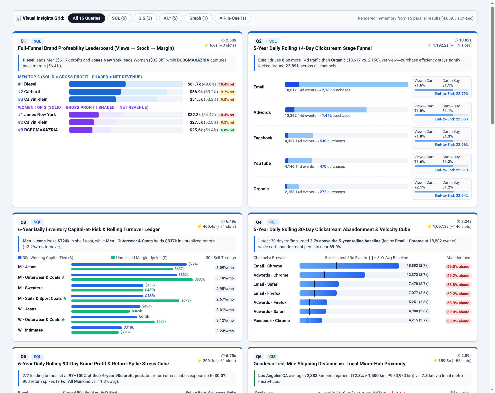
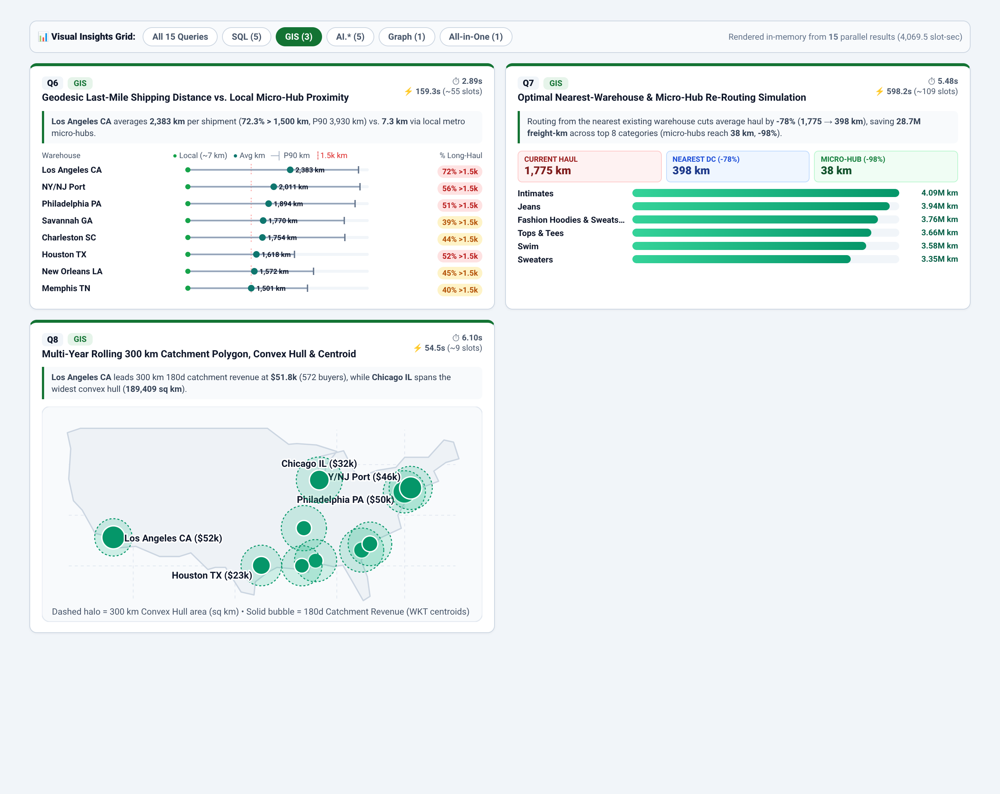
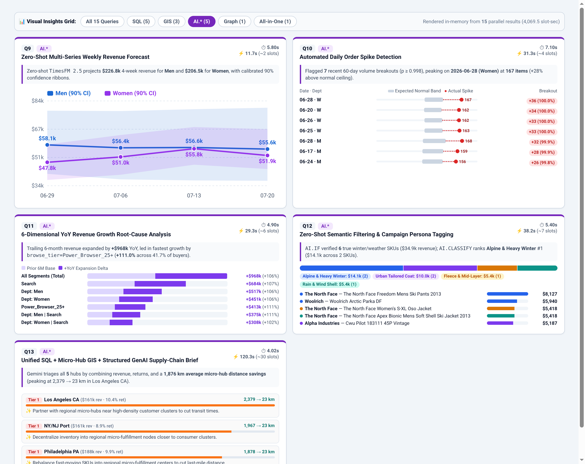
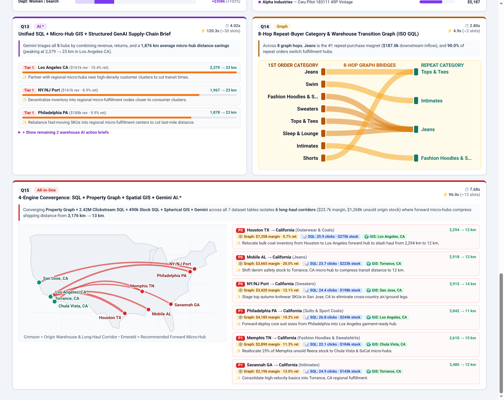
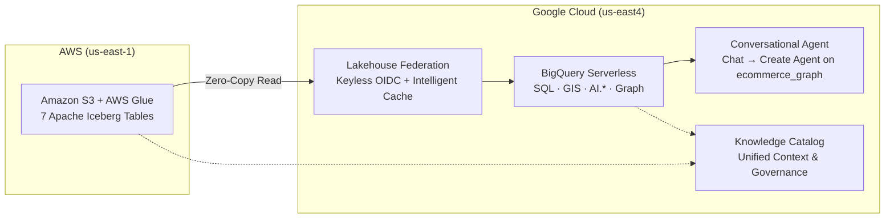

# Cross-Look — Unified Serverless BigQuery SQL, GIS, AI & Graph… with an Amazon S3 Twist

**Cross-Look** is a live, customer-reproducible demo built around a **4-section narrative with a cross-cloud twist**:

1. **Analytics & AI**: Launch 15 concurrent queries in `~10 seconds` in [`notebooks/thelook_analytics_ai_demo.ipynb`](notebooks/thelook_analytics_ai_demo.ipynb), uniting **`SQL`**, **`GIS`**, **`AI.*`** (`TimesFM 2.5` & Gemini), and ISO **`Graph`** (`GQL`) in one serverless engine — with zero mention of AWS, S3, or Apache Iceberg.
2. **Conversational Graph Agent**: Click **Chat** → **Create Agent** on `thelook_commerce.ecommerce_graph` in BigQuery Studio to ask multi-hop supply-chain and revenue questions in plain English, grounded by semantic `MEASURE(...)` definitions.
3. **Storage & Telemetry (*The Twist: The Data Was on Amazon S3 All Along*)**: Inspect BigQuery's system catalog and job telemetry (`Cache Analysis`) to reveal **`0 bytes` stored in BigQuery** — every query and Graph Agent answer ran directly over **Apache Iceberg tables in Amazon S3 and AWS Glue**, federated natively with zero ETL and accelerated by regional **Intelligent caching** (`0.00 MB` over the wire once warm).
4. **Knowledge Catalog**: Open **Knowledge Catalog** to demonstrate how a single discovery and context plane automatically indexes and serves LLM-ready context (`:lookupContext`) across both Amazon S3 Iceberg tables (`@biglake`) and BigQuery Property Graphs (`@bigquery`).

---

## Notebook Visual Insights Grid Preview

Cell 3 of [`notebooks/thelook_analytics_ai_demo.ipynb`](notebooks/thelook_analytics_ai_demo.ipynb) translates all 15 parallel query results into executive decision cards — illustrating the business value of combining full-funnel brand margin analysis, inventory working-capital optimization, geospatial freight routing, AI demand forecasting, and multi-hop graph journeys:

| `SQL` — Elastic Analytical GoogleSQL (`Q1`–`Q4`) | `GIS` — Elastic Geospatial (`GIS (3)` Filter) |
| :---: | :---: |
|  |  |
| **`AI.*` — `TimesFM 2.5` & Gemini (`AI.* (5)` Filter)** | **`Graph` (`Q14`) & `All-in-One` (`Q15` 4-Engine Hero Card)** |
|  |  |

---

## Quickstart Setup

> **Tip**: The only prerequisite is an authenticated **`gcloud` CLI** and **`aws` CLI** (`v2.32.0+`). Run in [**Google Cloud Shell**](https://shell.cloud.google.com/) (`gcloud`, `bq`, and `python3` pre-installed) or any Linux/macOS terminal.

### Step 0: Request an Argolis AWS Environment

If you do not already have an AWS sandbox account, request an Argolis AWS environment by following [go/use-argolis-aws](http://go/use-argolis-aws).

- **Estimated AWS Spend**: The bill will be mainly **Amazon S3 data storage** (plus minimal one-time serverless Athena CTAS & Glue metadata requests) — [example AWS Pricing Calculator estimate](https://calculator.aws/#/estimate?id=16b7f9267727e17d506dd3a900d5c8a24e494d0e).

---

### Step 1: Authenticate `gcloud` & `aws` CLI

#### 1.1 Sign In to Google Cloud CLI
Install the [Google Cloud CLI (`gcloud` + `bq`)](https://cloud.google.com/sdk/docs/install) if not already installed, then sign in:

```bash
gcloud auth login
```
*(You can select your existing Google Cloud project now via `gcloud config set project YOUR_PROJECT_ID`, or confirm / enter it interactively when `./deploy.sh` starts.)*

#### 1.2 Install AWS CLI v2 (`v2.32.0+`) & Sign In with `aws login --remote`
> **Important**: Browser-based **`aws login --remote` requires AWS CLI `v2.32.0` or newer** (older OS packages fail with `Found invalid choice 'login'`). Install or upgrade in user space (`~/.local/bin`, persistent across Cloud Shell restarts):

**Linux (`x86_64` / `ARM64`) & Google Cloud Shell:**
```bash
curl -fsSL "https://awscli.amazonaws.com/awscli-exe-linux-$(uname -m).zip" -o "/tmp/awscliv2.zip"
unzip -q -o /tmp/awscliv2.zip -d /tmp
/tmp/aws/install --update -i "$HOME/.local/aws-cli" -b "$HOME/.local/bin"
rm -rf /tmp/aws /tmp/awscliv2.zip
export PATH="$HOME/.local/bin:$PATH"
grep -qxF 'export PATH="$HOME/.local/bin:$PATH"' ~/.bashrc 2>/dev/null || echo 'export PATH="$HOME/.local/bin:$PATH"' >> ~/.bashrc
hash -r && aws --version   # Verify aws-cli/2.32.0 or newer
```

**macOS (Homebrew):**
```bash
brew install awscli || brew upgrade awscli
aws --version   # Verify aws-cli/2.32.0 or newer
```

Sign in with your AWS Console credentials from any local or remote terminal:

```bash
aws login --remote
```

1. **Select Region**: Enter `us-east-1` (or `us-west-2`, `eu-central-1`, `eu-west-2`).
2. **Approve in Browser**: Open the printed verification URL, sign in to AWS, and approve the request *(or use `aws login` / `aws sso login` if preferred)*.

---

### Step 2: Clone & Run `./deploy.sh` (`~5–7 minutes`)

```bash
git clone https://github.com/cloud-gtm/cross-look.git
cd cross-look
./deploy.sh
```

`./deploy.sh` walks you through 3 interactive gates before creating anything:

1. **Parameters**: Auto-detects your active `gcloud` project, AWS account, and co-located AWS ↔ GCP region pair (`us-east-1` ↔ `us-east4`, `us-west-2` ↔ `us-west1`, `eu-central-1` ↔ `europe-west3`, or `eu-west-2` ↔ `europe-west2`) for confirmation.
2. **Pre-Flight Check**: Verifies CLI tools, APIs, billing, and AWS/GCP permissions — asking `[Y/n]` before enabling missing APIs or granting IAM roles.
3. **Resource Plan & Provisioning**: Displays the exact AWS and GCP resources to create, asks for your go-ahead, and exports `bigquery-public-data.thelook_ecommerce` (`7 tables`) to Amazon S3 as AWS Glue Apache Iceberg tables federated into BigQuery (`thelook_catalog`, Cross-Cloud Cache enabled) + `thelook_commerce.ecommerce_graph` (`0 bytes` stored in BigQuery).

> **Flags**: `--yes` (non-interactive), `--skip-export` (reuse staged S3 Parquet), `--skip-export --skip-glue` (re-run GCP federation + graph only).

---

### Step 3: Run the Interactive Demo in BigQuery Studio

1. Open [**BigQuery Studio**](https://console.cloud.google.com/bigquery) in the Google Cloud Console and confirm your project is selected in the top bar.
2. In the left **Explorer** pane, expand your project → next to **Notebooks**, click **⋮ (View actions) → Upload notebook**.
3. Select [`notebooks/thelook_analytics_ai_demo.ipynb`](notebooks/thelook_analytics_ai_demo.ipynb) and click **Upload**.
4. Click **Run all** (or step through the cells) and follow the walkthrough directly inside the notebook.

> **Going Further Outside the Notebook**: You can also create **Talk-to-Data** (`Conversational Analytics`) agents directly on the remote federated dataset (`thelook_catalog.thelook_ecommerce`) or query it from **Gemini Enterprise** using the **BigQuery (federated) connector**.

---

## Demo Thesis, Differentiators & Target Personas

- **Demo Thesis**: You do not need to copy data out of Amazon S3 or maintain brittle cross-cloud connectors to experience the full serverless power of BigQuery, Conversational Graph Agents, and unified AI governance. With **Lakehouse for Apache Iceberg** and **Knowledge Catalog**, Google Cloud brings unified **SQL, `GIS`, `AI.*`, ISO `GQL` Graph, Talk-to-Graph Agents, and storage-agnostic context management** directly to your existing AWS Glue + S3 Iceberg tables.
- **Key Differentiators**:
  1. **Unified Serverless Multi-Engine Compute (`SQL` + `GIS` + `AI.*` + `GQL`)**: Mobilizes `~400+` concurrent BigQuery slots (`~4,060+ slot-seconds` / `~68 CPU-minutes` in `~10s` wall-clock) across all 4 engines simultaneously — culminating in **`Q15`**, a single query combining `GRAPH_TABLE` (`GQL`), `ST_*` (`GIS`), relational SQL windowing, and `AI.GENERATE` across all 7 tables.
  2. **Native Conversational Graph Agent (`Chat` → `Create Agent` on `ecommerce_graph`)**: Grain-locked `MEASURE(...)` definitions and edge relationships on `thelook_commerce.ecommerce_graph` allow business users to chat with 5-entity e-commerce data in natural language (`GRAPH_EXPAND` / `GQL`) before knowing the underlying tables live on Amazon S3.
  3. **Native "Zero-Work" Cross-Cloud Federation & 4-Stage Byte Waterfall**: A federated **Lakehouse runtime catalog** syncs AWS Glue Iceberg snapshots every `300s` via keyless `sts:AssumeRoleWithWebIdentity` (`accounts.google.com`), while `INFORMATION_SCHEMA.JOBS_BY_PROJECT` proves **Logical Scan → Columnar Parquet Compression (`~3x–5x`) → Regional Intelligent Cache Hit (`~100%` warm) → Bytes Sent Over the Wire (`0.00 MB` warm)**.
  4. **Zero-Touch Storage-Agnostic Cataloging & Agentic Context (`Knowledge Catalog`)**: Automatically indexes `@biglake` (federated S3 Iceberg catalog, namespace & 7 tables with `AWS_GLUE`, `ICEBERG`, `s3://...` URIs and schemas) alongside `@bigquery` (`thelook_commerce` dataset + `ecommerce_graph` Property Graph with `OPTIONS(description=...)` and `MEASURE` definitions), exposing unified LLM context via `:lookupContext`.
- **Target Personas**: Chief Data & Analytics Officers (CDAOs), Enterprise Cloud Architects, Analytics Engineers, and Data/AI Platform Leads evaluating unified analytics, conversational agents, and governance over multi-cloud Apache Iceberg estates.

---

## End-to-End Architecture



### Product & Open-Source Inventory

| Layer | Technology | Role in This Demo |
| :--- | :--- | :--- |
| **Open Table Format** | **Apache Iceberg** (Parquet / Snappy) | Open table metadata, schema evolution, snapshot isolation, and columnar storage on Amazon S3 |
| **AWS Storage & Catalog** | **Amazon S3**, **AWS Glue Data Catalog**, **Amazon Athena**, **AWS IAM** | Hosts physical Iceberg data/metadata files, materializes Iceberg tables via CTAS, and grants keyless OIDC read access |
| **Cross-Cloud Federation** | **Lakehouse for Apache Iceberg** (Lakehouse runtime catalog + Intelligent caching) | Synchronizes AWS Glue Iceberg metadata every `300s` and caches hot Parquet column chunks in regional Google Cloud flash |
| **Analytical & Graph Compute** | **BigQuery** (GoogleSQL, Geospatial `ST_*`, **BigQuery Graph** ISO GQL) | Executes parallel rolling window cubes, geodesic polygon hulls, and 8-hop `GRAPH ... MATCH` / `GRAPH_TABLE` traversals |
| **In-Warehouse AI & Agents** | **BigQuery `AI.*`, Vertex AI & Conversational Analytics** (`TimesFM 2.5`, Gemini, **Chat → Create Agent**) | Runs `AI.FORECAST`, `AI.DETECT_ANOMALIES`, `AI.KEY_DRIVERS`, `AI.IF`, `AI.CLASSIFY`, `AI.GENERATE`, and natural-language Q&A on `ecommerce_graph` |
| **Context & Governance** | **Knowledge Catalog** (`@biglake` + `@bigquery` & `:lookupContext`) | Automatically indexes cross-cloud schemas, storage URIs, graph topology, and LLM YAML context across S3 Iceberg and BigQuery |

---

## Engineering Notes & Troubleshooting

- **`aws: [ERROR]: argument command: Found invalid choice 'login'`**:
  Your active `aws` binary is older than `v2.32.0` (or an OS package at `/usr/bin/aws` is shadowing `$HOME/.local/bin/aws`). Re-run the AWS CLI v2 `--update` installer in [Step 1.2](#12-install-aws-cli-v2-v2320--sign-in-with-aws-login---remote), then run `export PATH="$HOME/.local/bin:$PATH" && hash -r && which aws && aws --version` to verify `2.32.0+`.
- **BigQuery Studio runtime fails when no `default` VPC network exists**:
  Organizations enforcing `compute.skipDefaultNetworkCreation` may omit the `default` VPC network that Colab Enterprise's zero-config runtime expects. Either select an existing Runtime Template on your Shared/custom VPC in BigQuery Studio, or create `default` if your org policy allows it:
  ```bash
  gcloud compute networks create default --project="$GCP_PROJECT" --subnet-mode=auto
  ```
- **Why Athena CTAS instead of an AWS Glue Crawler?**
  Lakehouse federated AWS Glue catalogs federate **Apache Iceberg** tables (`table_type = 'ICEBERG'`). Standard AWS Glue Crawlers over raw Parquet files register legacy Hive tables, which are intentionally ignored by Iceberg catalog federation. `02_build_glue_iceberg.sh` uses serverless Athena CTAS (`WITH (table_type = 'ICEBERG', is_external = false, format = 'PARQUET')`) to write genuine Iceberg v2 metadata and manifest files on S3.
- **Why format `TIMESTAMP` and `GEOGRAPHY` during Step 1 export?**
  BigQuery Parquet `EXPORT DATA` writes `TIMESTAMP` as `INT64` (`TIMESTAMP_MICROS`), which causes a `SERIALIZATION_ERROR` in Athena Hive external staging tables, and writes `GEOGRAPHY` as GeoParquet binary WKB. Formatting `TIMESTAMP` to UTC ISO microsecond strings (`%Y-%m-%d %H:%M:%E6S`) and casting back via `CAST(col AS TIMESTAMP(6))` inside Athena CTAS produces native Iceberg timestamps, while WKT strings work seamlessly with BigQuery `ST_GEOGFROMTEXT(...)`.
- **`AccessDenied` on `HEAD_OBJECT ... metadata/*.metadata.json` right after rebuilding Glue tables**:
  If you re-run `02_build_glue_iceberg.sh` to drop and recreate an Iceberg table (deleting prior metadata files on S3) and immediately query BigQuery *before* the next 5-minute (`300s`) catalog refresh cycle, S3 returns `403 AccessDenied` for the deleted old metadata pointer under vended credentials. Wait up to 5 minutes (or run `gcloud beta biglake iceberg catalogs update thelook_catalog --refresh-interval=300s`) for the snapshot pointer to advance.

---

## Clean Teardown

Remove the BigQuery dataset, federated catalog, Cloud Storage staging bucket, AWS Glue database, AWS IAM role, and Amazon S3 bucket in one command:

```bash
./cleanup.sh
# Or non-interactively while keeping the S3 bucket:
# ./cleanup.sh --yes --keep-s3-bucket
```

---

## Repository Structure

```text
.
├── .env.example                             # Optional environment overrides template
├── LICENSE                                  # Apache 2.0 License
├── README.md                                # CLI quickstart, pre-flight & demo guide
├── requirements.txt                         # Pinned Python dependencies reference
├── deploy.sh                                # Interactive config, pre-flight & provisioning orchestrator
├── cleanup.sh                               # Safe teardown for AWS + Google Cloud resources
├── assets/                                  # Executive visual previews across SQL, GIS, AI.* & Graph
├── docs/
│   └── query_playbook.md                    # Standalone SQL/GQL reference & presenter talk track
├── notebooks/
│   └── thelook_analytics_ai_demo.ipynb      # 15-query notebook + Graph Agent + Twist + Knowledge Catalog
└── scripts/
    ├── 00_common.sh                         # Config detection, interactive confirmation & GCP/AWS pre-flight
    ├── 01_export_public_bq_to_s3.sh         # Exports public dataset -> GCS staging -> S3
    ├── 02_build_glue_iceberg.sh             # Builds 7 Apache Iceberg tables in AWS Glue via Athena
    ├── 03_federate_biglake_and_cache.sh     # OIDC Web Identity federation + Cross-Cloud Cache
    ├── 04_create_bq_graph.sh                # Zero-copy ISO GQL Property Graph DDL
    └── verify_setup.sh                      # Storage footprint & SQL/Graph verification
```
